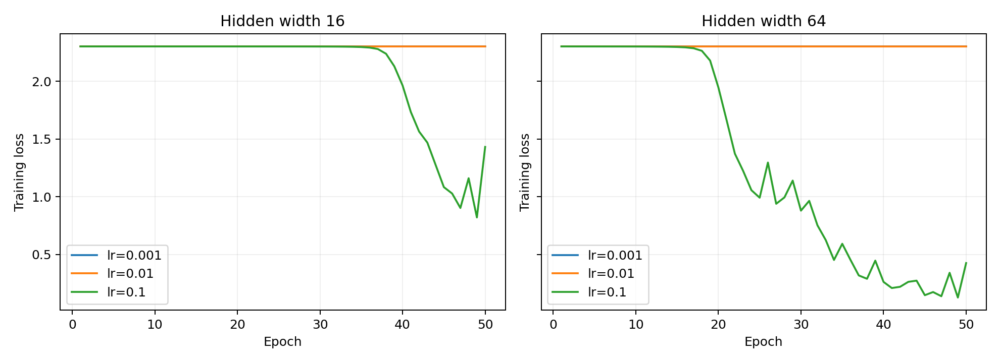

# Lab 2: A neural network from scratch

**Student:** G M Robi Farhan Rojob  
**Student number:** 73997  
**Course:** Machine Learning [CII5SE039CI]  
**Group:** 01

## 1. Goal

Implement a two-hidden-layer classifier for handwritten digits using NumPy. Check its gradients numerically, compare the required learning rates and hidden widths, and measure the forward and backward passes separately.

## 2. Method

### Data

The load_digits dataset contains 1,797 images of size 8 by 8. Each image is represented by 64 inputs. Pixel values were divided by 16 and labels were one-hot encoded into ten columns. A stratified 70/30 split with random_state=42 produced 1,257 training samples and 540 test samples. The test set was not used for updates or early stopping.

### Architecture and initialization

The network is **64 inputs → W neurons → ReLU → W neurons → ReLU → 10 outputs → softmax**, using W=16 and W=64. Biases start at zero. Normal weights use mean 0 and standard deviation 0.01. This states the convention used for the manual's N(0, 0.01) notation; interpreting 0.01 as variance would instead require standard deviation 0.1.

| Parameter | W=16 | W=64 |
|---|---|---|
| First weights / bias | (64,16) / (16,) | (64,64) / (64,) |
| Second weights / bias | (16,16) / (16,) | (64,64) / (64,) |
| Output weights / bias | (16,10) / (10,) | (64,10) / (10,) |
| Total trainable parameters | 1,482 | 8,970 |

### Forward propagation and loss

For batch size $B$, $Z_1=XW_1+b_1$, $A_1=\max(0,Z_1)$, $Z_2=A_1W_2+b_2$, $A_2=\max(0,Z_2)$, and $Z_3=A_2W_3+b_3$. Softmax subtracts the maximum logit in each row before exponentiation. Its output has shape $(B,10)$ and each row sums to one.

The mean cross-entropy is $L=-\frac{1}{B}\sum_i\sum_kY_{ik}\log(P_{ik})$. The implementation computes log probabilities directly from logits for numerical stability. Uniform predictions give ln(10)=2.302585.

### Gradient derivation

For one example, the softmax derivative is $\partial p_j/\partial z_k=p_j(\delta_{jk}-p_k)$. Cross-entropy gives $\partial\ell/\partial p_j=-y_j/p_j$. Combining these and using $\sum_jy_j=1$ gives $\partial\ell/\partial z_k=p_k-y_k$. Therefore:

$$D_3=(P-Y)/B$$

$$\nabla W_3=A_2^TD_3,\quad\nabla b_3=\sum_iD_{3,i}$$

$$D_2=(D_3W_3^T)\odot\mathbf{1}_{Z_2>0},\quad\nabla W_2=A_1^TD_2,\quad\nabla b_2=\sum_iD_{2,i}$$

$$D_1=(D_2W_2^T)\odot\mathbf{1}_{Z_1>0},\quad\nabla W_1=X^TD_1,\quad\nabla b_1=\sum_iD_{1,i}$$

Each gradient has the same shape as its parameter. The batch average is applied once, in D3. The ReLU derivative is taken as zero at zero. All gradients are calculated before any parameter is updated.

### Numerical checking and training

Before training, ten distinct weights were sampled uniformly from the three weight arrays for each width, using seed 42 and the first eight training examples. The centered estimate was [L(w+1e-5)-L(w-1e-5)]/(2e-5). Relative error was |analytic-numerical| / max(1e-12, |analytic|+|numerical|). The required threshold is below 1e-6 for at least nine of ten weights. No failed coordinate was replaced. A separate forward calculation uses Python Decimal at 50-digit precision to avoid cancellation between almost equal losses; analytical gradients and training use NumPy float64. The CSV also records whether a perturbation crosses a ReLU kink.

Every experiment starts from fresh parameters. Mini-batch SGD uses batches of 32 and 50 epochs. The final batch contains nine samples. Learning rates are 0.001, 0.01 and 0.1. Parameters and the shuffle generator both use seed 42; the initial weights and sequence of shuffled batches are identical across rates for a fixed width. Python, NumPy and PyTorch seeds are set as listed in the course rules. PyTorch is used only for those seed calls; no model operation or gradient uses it. Predictions use the largest output probability.

### Timing protocol

Forward and backward were each warmed up once and then timed separately 100 times with perf_counter_ns on a fixed batch of 32. The reported statistic is the median. Backward uses a cache prepared before timing, so it excludes the forward pass. Timers exclude loss evaluation, weight updates, logging and plotting. BLAS was limited to one thread. The measurements describe this computer and may change with hardware or system load.

### Environment

Python 3.11.8, NumPy 1.26.4, SciPy 1.13.1, scikit-learn 1.5.0, Matplotlib 3.9.0, joblib 1.4.2 and PyTorch 2.3.1 were used. All installed library versions are recorded in [results/versions.txt](results/versions.txt). The course-wide requirements are preserved at repository root. That full list cannot resolve unchanged because mlflow 2.14.1 requires pyarrow below 16 while the manual pins pyarrow 16.1.0. The experiment uses the matching Lab 2 subset in requirements-lab02.txt; it does not claim that the full course stack was installed.

## 3. Results

### Sanity checks and gradient evidence

| Width | Initial loss | Largest probability row-sum error | Gradient check |
|---:|---:|---:|---|
| 16 | 2.30258349 | 4.441e-16 | 10/10 passed before training |
| 64 | 2.30259491 | 3.331e-16 | 10/10 passed before training |

Full per-weight results: [gradient_check.csv](results/gradient_check.csv). Zero gradients and failures, if any, remain in that file. A sampled gradient check is not a proof of every derivative; independent directional tests also cover all three weight arrays and all three bias arrays.

### Training comparison

| Width | Learning rate | Final train loss | Train accuracy | Test loss | Test accuracy |
|---:|---:|---:|---:|---:|---:|
| 16 | 0.001 | 2.302549 | 0.1018 | 2.302549 | 0.1019 |
| 16 | 0.01 | 2.302475 | 0.1018 | 2.302475 | 0.1019 |
| 16 | 0.1 | 1.432382 | 0.4861 | 1.474272 | 0.4722 |
| 64 | 0.001 | 2.302519 | 0.1018 | 2.302517 | 0.1019 |
| 64 | 0.01 | 2.302261 | 0.1018 | 2.302262 | 0.1019 |
| 64 | 0.1 | 0.426592 | 0.8624 | 0.502877 | 0.8611 |

Accuracy is expressed as a fraction. The highest observed test accuracy was 86.11%, with width 64 and learning rate 0.1. This is a comparison of the six prescribed runs. Selecting a model using these test results would require a separate validation/test protocol for an unbiased final estimate.

All 300 per-epoch measurements are in [epoch_log.csv](results/epoch_log.csv). These curves show full-training-set loss after each epoch. No test-set curve was used to make training decisions.

### Timing breakdown

| Width | Learning rate | Forward median (microseconds) | Backward median (microseconds) | Backward / forward |
|---:|---:|---:|---:|---:|
| 16 | 0.001 | 17.70 | 18.80 | 1.06 |
| 16 | 0.01 | 17.60 | 18.70 | 1.06 |
| 16 | 0.1 | 18.00 | 19.10 | 1.06 |
| 64 | 0.001 | 38.40 | 51.30 | 1.34 |
| 64 | 0.01 | 39.10 | 51.60 | 1.32 |
| 64 | 0.1 | 38.65 | 51.60 | 1.34 |

Backward was slower in 6 of six measured configurations. Forward performs three matrix multiplications, with work proportional to B(64W+W²+10W). Backward performs five, with work proportional to B(64W+2W²+20W), because both parameter gradients and hidden-layer gradients are needed. It does not calculate an unnecessary input gradient. Small matrices, allocation overhead, softmax and operating-system noise also affect the measured ratio. The hidden-to-hidden matrix terms grow quadratically with hidden width; the input and output terms grow linearly.

[timing.csv](results/timing.csv) contains medians; [timing_raw.csv](results/timing_raw.csv) contains all 600 timing pairs. [verification.txt](results/verification.txt) records the independent tests.

## 4. Three conclusions

1. In this experiment, width 64 with learning rate 0.1 gave the highest test accuracy, 86.11%. The settings matter: the same architecture can make little progress with a smaller learning rate in the fixed 50 epochs.
2. Numerical checking agreed with the analytical gradients to the required standard before training. This provides evidence that the chain-rule implementation is correct, rather than relying only on whether the loss decreases.
3. The backward pass was slower in 6 of six measurements. It performs more matrix products than the forward pass, so increasing the hidden width has a computational cost as well as changing the number of trainable parameters.

## References

- Course Lab Manual, Student Edition: global rules and exact Python stack, pages 1-2; Lab 2: A neural network from scratch, page 4.
- Assigned reading: Vijay Janapa Reddi, Introduction to Machine Learning Systems: Principles and Practices of Engineering Artificially Intelligent Systems, Chapter 3, sections 3.4, 3.5.1-3.5.5 and 3.6.
