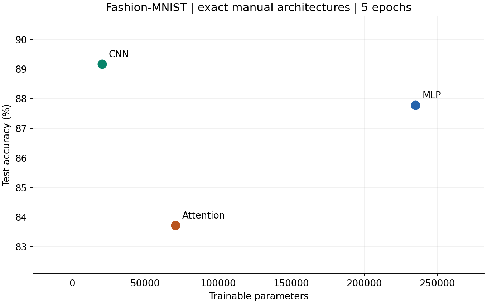
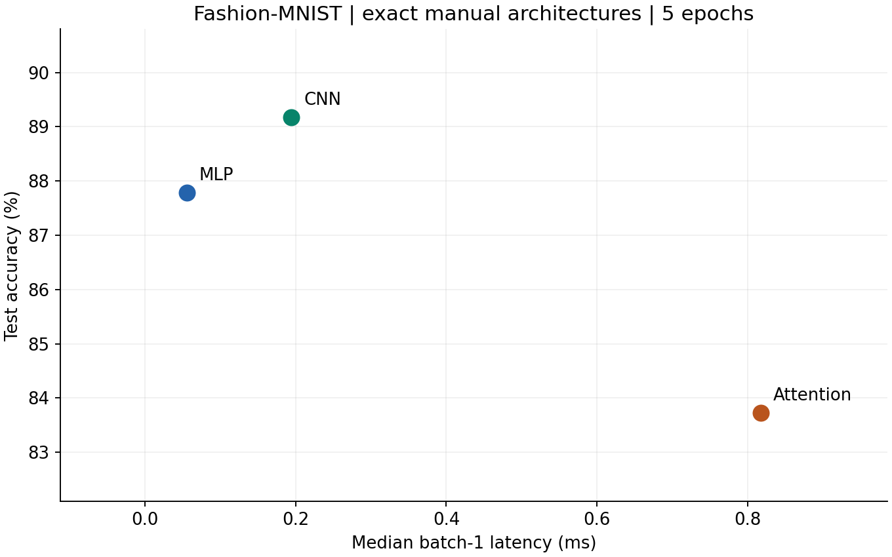
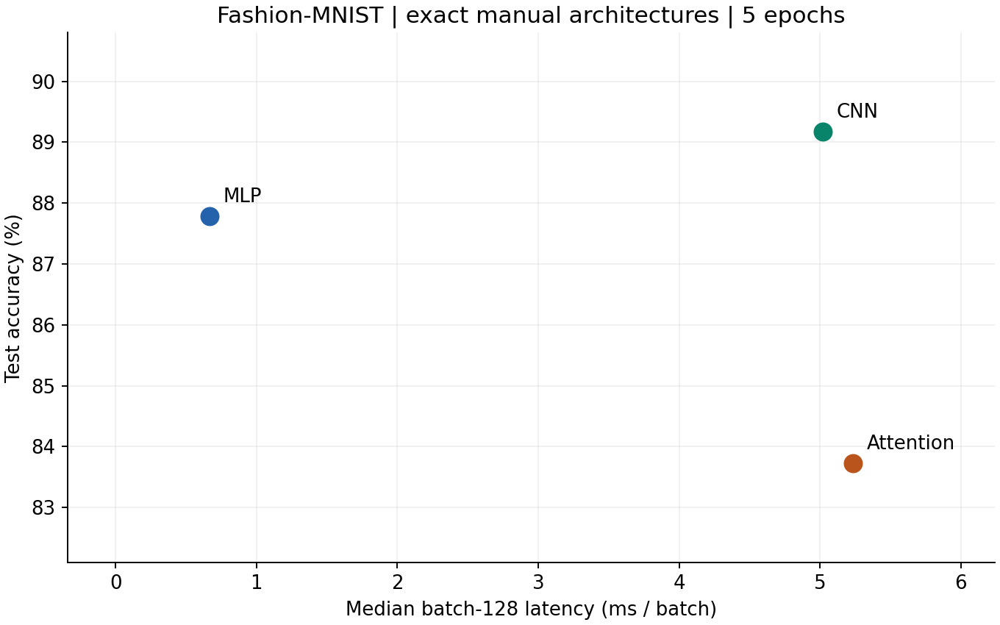
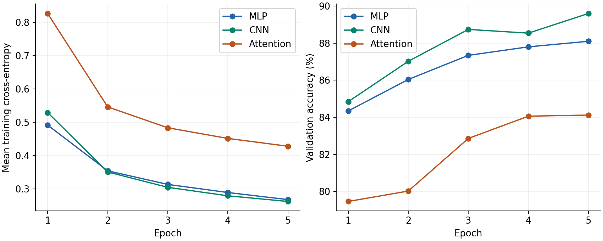

# Lab 3: Architectures and their costs

**Student:** G M Robi Farhan Rojob  
**Student number:** 73997  
**Course:** Machine Learning [CII5SE039CI], Group 01

## 1. Goal

Compare the prescribed MLP, CNN and attention classifier on Fashion-MNIST using test accuracy, trainable parameters, representative arithmetic work and measured inference latency.

## 2. Method

### Dataset and reproducibility

Used torchvision.datasets.FashionMNIST with ToTensor() followed by Normalize((0.2860,), (0.3530,)). An image becomes a float32 tensor of shape (1,28,28). The official 60,000 training images were split into 55,000 training and 5,000 validation examples using random_split and generator seed 42; this is a random, non-stratified split. The official 10,000 test images remained separate. Split indices, class counts and SHA-256 dataset hashes are saved in results. No augmentation was added. Training uses shuffled batches of 128 with an independent generator seeded 42 for each model; validation and test are unshuffled.

Python random, NumPy, torch.manual_seed and torch.cuda.manual_seed_all all use 42. The same split and epoch shuffle sequence are used for all models. Training uses Adam with learning rate 0.001 and default betas (0.9,0.999), epsilon 1e-8 and zero weight decay. All models train for exactly five epochs using cross-entropy on raw logits. The last training batch has 88 examples: 429 full batches plus one partial batch, or 430 updates per epoch. Validation is recorded after each epoch. Test accuracy is measured once per model using the final epoch, with no test-driven early stopping, tuning or checkpoint selection.

### Exact architectures and the conflicting size target

| Model | Layers | Parameters |
|---|---|---:|
| MLP | Flatten 784; Linear 256; ReLU; Linear 128; ReLU; Linear 10 | 235,146 |
| CNN | Conv 1->16, 3x3, padding 1; ReLU; MaxPool 2; Conv 16->32, 3x3, padding 1; ReLU; MaxPool 2; Flatten; Linear 1568->10 | 20,490 |
| Attention | 16 non-overlapping 7x7 patches; Linear 49->64; two encoder layers (64 features, 4 heads, feedforward 128); mean over 16 tokens; Linear 64->10 | 70,794 |

The requested 100,000-150,000 parameter target is incompatible with ALL THREE explicit architectures. The exact layer specifications take precedence in this implementation. This is therefore an architecture comparison, not a parameter-matched experiment. A controlled equal-size comparison would require teacher-approved changes to the specified widths. No silent resizing is used.

The attention encoder uses PyTorch's default ReLU feedforward, dropout 0.1 during training, two affine LayerNorms per layer, biases, post-normalization and independent initialization of the two layers. Dropout is disabled at evaluation. The manual does not specify positional embeddings or a class token; neither is added. This makes the final attention classifier invariant to a permutation of whole patches in evaluation (within-patch pixel order still matters), limiting its spatial information. Standard PyTorch default initializers are used for every model.

### Cost convention and profiler coverage

Parameters include weights and biases, plus LayerNorm scale and shift. Counts from torchinfo.summary are checked against sum(p.numel()). The full nested summaries are saved as torchinfo_*.txt.

The hand convention counts one multiply-accumulate as TWO FLOPs and reports one-image forward work. It includes dense products, convolutions and attention matrix products; it excludes bias additions, ReLU, comparisons in pooling, softmax, normalization, residual additions and mean pooling. These are representative arithmetic counts, not every instruction executed by the CPU. Batch-128 arithmetic is 128 times the one-image amount under this convention.

Native thop.profile counts module operations using its default rules; linear and convolution terms are MACs. The native output is retained without relabeling it as a complete FLOP measurement. A second profile adds an explicit MultiheadAttention rule and excludes LayerNorm so that its counting convention matches the handwritten formulas. Its agreement checks shape/count consistency; the custom rule itself uses the analytical formula and is not an independent hardware measurement.

For profiling only, PyTorch's fused attention/encoder fast path is disabled so module hooks observe execution. It is restored before training and latency measurements. Models are deep-copied for profiling to keep counting hooks and buffers out of the trained model.

### Timing protocol and actual environment

Inference uses CPU float32, model.eval() and torch.inference_mode(), with 4 intra-operation threads and one inter-operation thread. Hardware: Intel64 Family 6 Model 197 Stepping 2, GenuineIntel; 16 logical CPUs; Windows-10-10.0.26200-SP0. Python 3.11.8, PyTorch 2.3.1+cpu. The same first 128 official test images supply the batch-128 input; its first image supplies batch 1.

Each model/batch combination is warmed up once. Then batch 1 is timed 100 times and batch 128 is timed 20 times with perf_counter_ns; medians are reported. Inputs are prepared and made contiguous outside the timer. Timing includes the model call, patch rearrangement and mean pooling where relevant, but excludes image loading, transforms, loss, prediction scoring and disk I/O. CPU operations are synchronous. The raw 360 measurements are saved in latency_raw.csv. Batch latency and amortized per-image time are distinguished; batching can increase total response time while improving throughput. Timings describe this run, not a universal ranking or a production tail-latency guarantee.

All installed versions and the status of every course pin appear in versions.txt. Lab dependencies match the prescribed versions. The course-wide requirements.txt is preserved, but its mlflow 2.14.1 / pyarrow 16.1.0 conflict prevents installing that entire list unchanged (the prior Lab 2 resolver evidence is retained as course_stack_conflict.txt). The matching Lab 3 subset was used; unused course libraries are explicitly marked absent.

## 3. Results

| Model | Parameters | Test correct / 10,000 | Test accuracy | B1 ms | B128 ms | B128 ms/image |
|---|---|---|---|---|---|---|
| MLP | 235,146 | 8779 | 87.79% | 0.0556 | 0.6660 | 0.005203 |
| CNN | 20,490 | 8917 | 89.17% | 0.1943 | 5.0201 | 0.039220 |
| Attention | 70,794 | 8373 | 83.73% | 0.8176 | 5.2359 | 0.040905 |

Accuracy denominator is exactly 10,000. Saved state dictionaries reproduce these scores without retraining. Epoch logs contain 15 entries.

### Hand calculations and measured profiler output

| Model | Hand FLOPs | Native THOP output | 2 x native | Aligned THOP MACs | 2 x aligned |
|---|---|---|---|---|---|
| MLP | 469,504 | 234,752 | 469,504 | 234,752 | 469,504 |
| CNN | 2,063,488 | 1,031,744 | 2,063,488 | 1,031,744 | 2,063,488 |
| Attention | 2,329,856 | 591,488 | 1,182,976 | 1,164,928 | 2,329,856 |

**Linear example:** 2 x 784 x 256 = 401,408 FLOPs. Complete MLP: 401,408 + 65,536 + 2,560 = 469,504.

**Convolution example:** first output is 16 x 28 x 28 because stride=1 and padding=1. 2 x 3 x 3 x 1 x 16 x 28 x 28 = 225,792 FLOPs. Second convolution: 2 x 3 x 3 x 16 x 32 x 14 x 14 = 1,806,336. Final linear: 2 x 1,568 x 10 = 31,360. Total: 2,063,488.

**Attention example:** L=16, d=64, h=4, d_head=16. QKV costs 2 x 16 x 64 x 3 x 64 = 393,216. Score products cost 4 x 2 x 16 x 16 x 16 = 32,768; weighted values cost another 32,768. Output projection costs 131,072. Each feedforward projection costs 262,144. One full encoder therefore costs 1,114,112. Patch projection costs 100,352; two encoders cost 2,228,224; classifier costs 1,280. Whole model: 2,329,856 FLOPs. Four heads are already included through h x d_head = d; do not multiply this total by four again.

**Why THOP differs:** MLP and CNN native counts become the handwritten counts after multiplication by two. Native THOP omits both attention modules (including their output projections), missing 589,824 MACs across two encoders, but adds 16,384 normalization operation units outside our matrix-only convention. Thus 1,164,928 - 589,824 + 16,384 = 591,488 native units. Doubling yields 1,182,976, which is 1,146,880 below our 2,329,856 FLOPs. Native THOP also reports only 37,514 attention-model parameters because it misses 33,280 attention parameters. torchinfo and direct parameter enumeration agree at 70,794. The aligned profile produces 1,164,928 MACs and 70,794 parameters. Missing-rule logs are retained. THOP estimates operation counts; it does not measure executed hardware instructions.

The expanded derivation is in hand_calculations.md. The handwritten pages required by the teacher must be produced separately by the student.

### Trade-off plots

### Architecture and access-pattern explanation

Sections 4.6-4.7 and Table 4.2 connect architecture to computation, memory access and data movement. Dense MLP layers use regular matrix products and can reuse weights across a batch. CNNs share small filters across spatial locations; overlapping windows permit local reuse, while convolution still performs work at every output location. This explains how the CNN can have far fewer parameters but more FLOPs than the MLP. Attention combines learned projections with input-dependent pairwise interactions and reductions; it moves intermediate Q/K/V tensors and score/value data. Its interaction terms scale quadratically with token count. Dense PyTorch attention can implement these interactions with regular optimized kernels: the textbook's high-level random/gather description does not prove random physical memory accesses or cache misses in this particular run.

These access-pattern explanations motivate the measurements; no cache-miss, bandwidth or energy counters were collected, so this run cannot establish an actual memory bottleneck. All else equal, a short sequence of 16 tokens limits the quadratic term, but the projections and feedforward matrices still cost arithmetic.

In this run, CNN has the highest test accuracy (89.17%), MLP has the lowest single-image latency (0.0556 ms), and CNN has the fewest parameters (20,490). The CNN is the storage-efficient choice; a latency-critical choice should follow the measured batch-specific latency and acceptable accuracy. The most cost-effective architecture depends on that constraint, rather than one score combining incompatible units. Results do not show that every CNN or Transformer would rank this way: sizes differ, only one seed was trained, and training lasts only five epochs.

## 4. Three conclusions

1. The specified architectures are not equal in size: the MLP has 235,146 parameters, the CNN 20,490 and attention 70,794. Parameter count measures stored learned values, whereas FLOPs count how often arithmetic is performed.
2. Correct profiler comparison requires matching conventions and coverage. The MLP and CNN agree after converting MACs to FLOPs; default THOP misses attention operations, so the default and explicit-rule results must both be shown.
3. For this five-epoch run, CNN achieved the highest accuracy and MLP was fastest for one-image inference. I would choose a model according to the accuracy, storage and batch-latency budget, rather than parameter count alone.

## References

1. Course Lab Manual, Student Edition: global rules and exact stack, printed pp. 1-2; Lab 3, printed p. 5 (the supplied one-page PDF).
2. Vijay Janapa Reddi, *Introduction to Machine Learning Systems: Principles and Practices of Engineering Artificially Intelligent Systems*, 31 July 2025 edition, user-supplied introduction-to-machine-learning-systems_compress.pdf. In this exact copy: section 4.2 pp. 153-157 (PDF pages 205-209); 4.3 pp. 158-163 (210-215); 4.5 pp. 169-176 (221-228); 4.6 pp. 177-181 (229-233); 4.7 pp. 182-188 (234-240). Printed page p is PDF viewer page p+52. Key source locations: Listing 4.2 on p. 156; Listing 4.4 on p. 161; section 4.5.2.3 on pp. 171-172; Table 4.2 on p. 181; sections 4.7.2-4.7.3 on pp. 184-187. Exact book SHA-256 is in reference_record.json. A public author-hosted edition was checked initially, but its different pagination is not used for these references.
3. [THOP upstream documentation](https://github.com/Lyken17/pytorch-OpCounter): MAC reporting and custom operation hooks. Installed version's rules were inspected for this run.
4. [torchvision 0.18 FashionMNIST documentation](https://docs.pytorch.org/vision/0.18/generated/torchvision.datasets.FashionMNIST.html).
5. PyTorch 2.3.1 installed TransformerEncoderLayer implementation and torchinfo 1.8.0; versions recorded in results.
