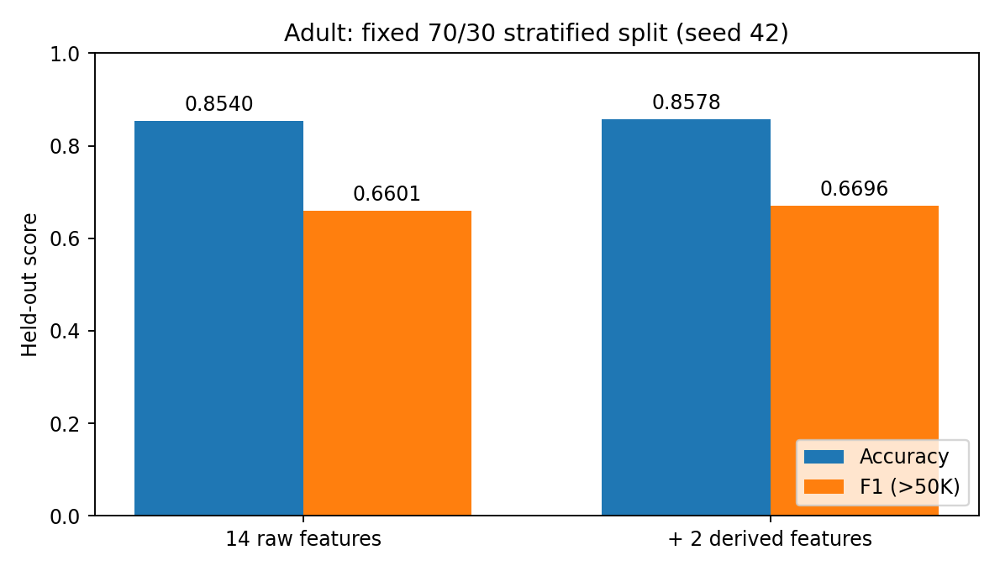

# 1. What you are building

**Lab 4 explained - G M Robi Farhan Rojob, 73997**

This lab turns a mixed table into reproducible model inputs. The main result is the data pipeline: a sequence that can be fitted once on training data and safely reused on test data or new records. The logistic classifier checks that the processed features are useful.

The Adult dataset has 48,842 rows. Each row has 14 predictors and an income category. Six predictors are numeric; eight are categorical. The positive label means annual income above USD 50,000 in the historical source. The OpenML target column is called class; the working copy calls it income.

| Stage | What the supplied run establishes |
|---|---|
| Ingest | 48,842 rows x 15 columns; raw values preserved |
| Validate | 0 schema/range/dictionary violations; missingness counted |
| Split | 34,189 raw train / 14,653 test, stratified with seed 42 |
| Clean | 24 duplicate train rows removed; 34,165 used for fitting |
| Compare | Accuracy and positive-class F1 for both fixed feature sets |
| Audit | Five conflicting-label groups, 50 sampled rows for review |
| Reproduce | Saved config, SHA256, fitted objects and identical second fit |

**Your four main graded artifacts** are the validation report, leakage-free fitted preprocessing, the complete data card and the one-command run. The report explains decisions and results; the results directory holds the measured evidence behind it.

**Before submission:** manually inspect the 50 sampled rows, record your actual findings in the worksheet, understand the source and rewrite the three draft conclusions in your own words. The automated checks are complete, while those personal tasks remain yours. A copy of the one-page lab manual is in references/ for class.

The manual's bracketed numbers describe estimated minutes. They are not scores. Read the supplied textbook sections using the page map on the final page of this guide.

---PAGE---

# 2. Why the split comes first

**Data leakage** occurs when information that should be unavailable during training influences the fitted system or its evaluation. Test labels leaking into features are an obvious example. Calculating an imputation median using the test rows is a subtler example: the training process has learned something about the held-out distribution.

The sequence here is:

Raw ingestion -> fixed dictionary validation -> stratified 70/30 split -> train-only duplicate removal -> fit preprocessing on train -> transform train and test -> fit classifier on train -> evaluate test.

Validation reads all raw rows against rules fixed in advance. It does not learn medians, thresholds, vocabularies or model settings. That is why read-only full-source validation can precede the split.

**Fit** learns a state from data. The state includes six medians, eight categorical modes, clipping bounds, scaling means/standard deviations and the one-hot vocabulary. **Transform** applies the saved state. The test partition receives transform only. Calling fit_transform on the test partition would create a different system and contaminate evaluation.

**Stratification** keeps class proportions close in each partition. Adult is about 23.93% >50K. The test set has 3,506 positive and 11,147 negative labels. Stratification handles class composition; it does not guarantee demographic balance or remove duplicate dependence.

The seed fixes which source IDs enter each split. It does not establish correctness by itself. The code saves all IDs and verifies their separation, then repeats the full fit and compares the actual outputs.

**A limitation you should be able to explain:** 24 test records are identical, including income, to retained training rows; 27 match the predictors regardless of income. The prescribed random row split leaves these matches. The code follows the required split and preserves all test rows, so the report distinguishes train-only fitted statistics from entity-independent evaluation. A group split would be a different experiment.

**Oral answer:** "I split before learning anything from the features. All fitted preprocessing uses only retained training IDs. I report the remaining duplicate overlap because a random row split does not guarantee independent entities."

---PAGE---

# 3. What validation checks

A **schema** is an explicit contract for names, types, categories, missingness and ranges. It makes an invalid input visible before a model can silently learn from it. Numeric-looking values must be integral; a float storage dtype alone is not a violation if the values are exact integers.

| Attribute | Schema and checks |
|---|---|
| age | Integer, inclusive 17-90 |
| workclass | Category; fixed dictionary; ? permitted as missing |
| fnlwgt | Integer; at least 2 in the extra dictionary check |
| education | Category; fixed list of 16 education levels |
| education-num | Integer 1-16; agrees with education category |
| marital-status | Category; fixed dictionary |
| occupation | Category; fixed dictionary; ? permitted as missing |
| relationship | Category; fixed dictionary |
| race | Category; fixed dictionary |
| sex | Category; original dataset records Female or Male |
| capital-gain | Integer, inclusive 0-99,999 |
| capital-loss | Integer, inclusive 0-4,356 |
| hours-per-week | Integer, inclusive 1-99 |
| native-country | Category; fixed dictionary; ? permitted as missing |
| income | Category: <=50K or >50K; missing target rejected |

The manual specifies four numeric ranges. The implementation clearly labels the education and weight checks as additional dictionary checks. Allowed category lists come from the UCI dictionary, rather than being inferred from the test set.

**Missingness is a separate result.** OpenML already exposes missing category values as NaN: workclass has 2,799; occupation 2,809; native-country 857. There are no literal ? values left in this parsed version, but the pipeline accepts either representation as feature missingness. Passing validation does not mean there are no missing values.

No invalid rows are silently discarded. Every invalid cell goes into validation_violations.csv; the run stops before fitting if any exist. The raw table remains unchanged. Read validation_report.md for the narrative and schema.json for the full machine-readable contract.

---PAGE---

# 4. Cleaning decisions learned from train

**Duplicates first, within training.** An exact duplicate means all 14 predictors and the income label match. The code retains the first occurrence in the fixed training order and removes 24 extra occurrences. It does not merge feature-identical records with conflicting targets or delete test duplicates.

**Imputation** fills missing inputs so later calculations can operate. The numeric median is the middle training value. The categorical mode is the most frequent observed training category. For example, the fitted age median is 37, weekly-hours median 40 and workclass mode Private. The occupation mode is Prof-specialty. These values are saved in fitted_parameters.json.

**Clipping** replaces values outside a training percentile interval with the nearest bound. For a value x, output = min(max(x, lower), upper). It limits extreme inputs without dropping rows.

| Numeric predictor | Fitted 1st percentile | Fitted 99th percentile |
|---|---:|---:|
| age | 17 | 74 |
| fnlwgt | 27,035.2 | 509,629 |
| education-num | 3 | 16 |
| capital-gain | 0 | 15,024 |
| capital-loss | 0 | 1,980 |
| hours-per-week | 8 | 80 |

An age of 90 passes the raw schema but becomes 74 in the model input. This is not a contradiction: schema validation checks permissible source values; clipping is a chosen model transformation. The original row and raw snapshot still contain 90. Percentiles are computed after training-only imputation, using NumPy's linear interpolation.

**Scaling** uses z = (x - training mean) / training standard deviation. It keeps numeric columns with very different units from dominating optimization. **One-hot encoding** gives each observed training category its own indicator column. Unknown future categories produce all zeros for that attribute, instead of forcing a refit.

The baseline has 105 encoded columns. The engineered version has 107. The transformer returns model-ready numbers while the source table stays available for auditing. Its fitted state is saved in results/preprocessor.joblib.

---PAGE---

# 5. Derived features and the classifier

The two formulas are fixed before testing and use cleaned/clipped numeric values. The original predictors remain present.

**capital_net = capital-gain - capital-loss.** If gain is 1,000 and loss is 200, capital_net is 800. This combines two existing inputs; it does not recover the total annual income label.

**hours_per_age = hours-per-week / (age - 16).** At age 36 with 40 weekly hours, the value is 40/20 = 2. The age offset is the lab's chosen formula, not verified employment experience. The valid age minimum 17 keeps the denominator positive; an explicit guard also rejects zero or negative denominators.

LogisticRegression learns a weighted sum of the encoded features and turns it into a positive-class probability. This run uses lbfgs, C=1, max_iter=2000, tol=0.0001 and threshold 0.5. Both models use the same split and retained training rows. No settings are chosen using test scores.

| Fixed feature set | Test accuracy | Test F1 for >50K |
|---|---:|---:|
| Original 14 | 0.853955 | 0.660102 |
| Original 14 + two derived | 0.857777 | 0.669626 |

Accuracy rises by about 0.382 percentage points, while F1 rises by 0.009524. This is a measured difference on one split, not a significance claim. F1 matters because most records are <=50K: always predicting that class would score about 76.07% test accuracy and zero positive-class F1.

capital_net is a linear combination of two existing numeric inputs, so it does not expand a linear model's unregularized function class by itself. With regularization it can still change the fitted solution. hours_per_age is nonlinear in age. This paired comparison cannot attribute the gain to either feature separately.

---PAGE---

# 6. Labels, conflicts and your review

An input can satisfy every type and range check while still having an incorrect income label. Label quality therefore needs a separate audit.

The code groups raw rows by all 14 predictors and counts the number of distinct income labels in each group. A group with both <=50K and >50K is a **conflict group**. In this dataset there are five such groups involving ten records. The raw table also has 52 exact full-row duplicate excesses and 57 feature-duplicate excesses. These are different counts and should not be used interchangeably.

Conflicting labels do not automatically prove an annotation mistake. Two different people can share every recorded predictor and have different annual incomes. The available predictors cannot establish which label to change. The pipeline reports the source IDs and keeps those labels.

**Your manual evidence:** results/manual_review_50.csv contains the fixed random sample, original values and blank review fields. Each row already has an automated dictionary result, but the blank fields are for your actual inspection.

1. Compare every field with the UCI dictionary or results/schema.json.
2. Check inclusive ranges, integer values, recognized categories and education/category agreement.
3. Treat ? as permitted feature missingness. Do not treat a large fnlwgt as income: it is a census weight.
4. Note suspicious combinations, distinguishing an impossible value from an unusual one.
5. Enter PASS, FLAG or UNCERTAIN; add the reason, your name and actual date.
6. Summarize your actual findings in the report and commit your changes.

The automation preserves this worksheet when rerun. It does not fill your identity/date or describe human inspection as completed. No impossible values were found by the automated sample checks, which is a narrower claim than manually verifying the rows.

The manual's alternative 24-hour relabeling and Cohen's kappa exercise applies to subjective-label datasets. Adult follows the duplicate-conflict route instead. There is no need to fabricate two rounds of human income labels.

**Oral answer:** "A schema pass establishes conformity to a dictionary. A conflict audit tests recorded-label consistency. Neither one independently verifies a person's true income."

---PAGE---

# 7. Hashing and reproducibility

**SHA256** maps a sequence of bytes to a 64-character hexadecimal fingerprint. Changing a value, row order, column order or line ending can change the fingerprint. You therefore need a defined serialization, not just a claim that two tables look similar.

The processed artifact contains 48,818 rows: 34,165 retained train plus all 14,653 test records. Columns contain split, source row_id, the binary label, and 107 engineered model inputs. Rows appear in fixed training order followed by fixed test order.

The CSV contract is UTF-8, LF line endings, header included, no pandas index, %.17g float formatting, and fixed ordered feature names. The file is data/lab04/processed_dataset.csv. Its SHA256 is:

`50a22304e1125a60d773b504cc25c762`

`597e74732c244b8bd8abfbce317cd115`

Join the two displayed lines without spaces. The complete single-line value is also in results/processed_dataset.sha256 and results/config.yaml.

**What the one-command run verifies:**

- The raw frame and raw CSV are unchanged.
- Source IDs are disjoint between the two partitions.
- The fitted cleaner uses exactly the retained training IDs.
- Reloading the joblib preprocessor returns identical transformed test values.
- A second independent fit repeats split, deduplication and both models.
- The second fit produces identical processed arrays, probabilities and predictions.
- The resulting canonical CSV fingerprint is identical.
- A fresh Python process reloads the saved artifacts and independently checks training statistics, predictions, scores and exported matrices.

The environment record includes Python 3.11.8 and all installed versions. Python, NumPy and the manual's torch seed calls use 42; numerical CPU work uses one thread. Version pinning and the cached source help make the seed meaningful.

A hash proves byte identity under this contract. It does not certify accurate labels, good sampling, fairness, privacy or validity for deployment. It is also not encryption. The data card supplies that missing context. Exact identity is verified on the recorded environment; arbitrary version or hardware changes can still change floating-point results.

---PAGE---

# 8. Run it and find the evidence

Open your existing course project in PyCharm. Select the Python 3.11.8 interpreter already used for the earlier labs. Its folder is still named .venv-lab2, but pandas and PyYAML have now been added for Lab 4. Open lab04/main.py, right-click and run it. The old root main.py still launches Lab 2.

**One command from the course root:** `python lab04/main.py`

The final console line says COMPLETE after replay, six focused tests and artifact verification pass. The first run needs access to OpenML; later runs use the sklearn download cache. The provided source resolves its paths from its own location, so an alternative PyCharm working directory does not move its outputs.

| File or folder | Read it for |
|---|---|
| report.md | Goal, half-page problem definition, method, results, draft conclusions |
| results/validation_report.md | Human-readable validation evidence |
| data_card.md | Source, attribution/license, size, quality, bias, privacy |
| config.yaml | Fixed source/split/preprocessing/model settings |
| src/schema.py and quality.py | Dictionary, ranges and conflict/duplicate checks |
| src/transforms.py | Train-fitted cleaning, formulas, scaling and encoding |
| src/run_lab.py | Ingestion, split, fitting, export, replay and orchestration |
| src/test_pipeline.py | Small independent fixtures for leakage and edge cases |
| src/verify_lab.py | Fresh-process verification without retraining |
| results/ | Fitted objects, measured CSVs, hashes, plots and logs |
| references/ | Your digital lab manual |

**Inspect without fitting again:** `python lab04/src/verify_lab.py`

On another computer, create a Python 3.11.8 environment and install lab04/requirements-lab04.txt. The full course requirements.txt is preserved, including the earlier documented mlflow/pyarrow conflict. The Lab 4 subset contains the required compatible packages; the installed-environment lock is also supplied.

Root data/ is ignored by Git and excluded from the submission ZIP. It contains the source snapshot, OpenML cache and processed dataset, which the code recreates. Preserve the local cache for offline class use. The ZIP contains source, config, reports and measured evidence, but no Python environment.

Before submission, complete your own sample review and personalize the conclusions. Review what the code does, then commit your actual changes. Bring the included manual in digital or printed form.

---PAGE---

# 9. Connect the lab to your reading

These references use the supplied July 31, 2025 textbook, Introduction to Machine Learning Systems by Vijay Janapa Reddi. Add 52 to a printed page number to find its PDF viewer page. The explanations here are a study map; read the specified sections yourself before class.

| Section / printed pages | Main idea and connection to Lab 4 |
|---|---|
| 5.2 / 206-207 | Lifecycle stages interact. Data-quality decisions influence modeling and evaluation. |
| 5.3 / 208-210 | Define the prediction, metric, users and constraints before collecting or fitting. |
| 5.4 / 211-214 | Collection needs quality, coverage and validation; preserve source provenance. |
| 5.5 / 215-217 | Model development requires experiment records, reproducible data and system constraints. |
| 6.2 / 242-246 | Bad data decisions can cause downstream cascades; define the problem first. |
| 6.3 / 247-248 | Separate source, ingestion, processing, labels and storage into explicit stages. |
| 6.4 / 248-258 | Existing datasets save work but can be stale or biased; document licensing/privacy. |
| 6.5 / 258-262 | Batch ingestion suits this table; load raw data before modeled transformations and validate errors explicitly. |
| 6.6 / 262-268 | Clean missingness/duplicates, transform and engineer features with a reusable pipeline. |
| 6.7 / 268-277 | Labels need quality checks and human oversight; audit conflicts and document uncertainty. |
| 6.8 / 278-288 | Store raw/processed data, metadata and versions separately; reuse the same feature definitions at inference. |

The exact overlap of section boundary pages reflects headings that start partway through a printed page. Source details and file hashes are in reference_record.json. The UCI dictionary is linked from report.md and data_card.md.

**Check your understanding before class:**

1. Why does fitting a median before splitting leak information? The held-out distribution influences the state learned for training.
2. Why can age 90 pass validation but become 74? A valid source range and a learned clipping interval serve different purposes.
3. Why preserve the transformer? New inputs must use the same training statistics and feature order.
4. Does an identical hash establish correct labels? It establishes identical bytes; correctness needs separate quality evidence.
5. Does stratification remove duplicate overlap? It controls class composition; it does not separate feature-identical groups.

This guide and the code were prepared with AI assistance. Your manual inspection, reading, understanding and own-word conclusions remain personal work.
